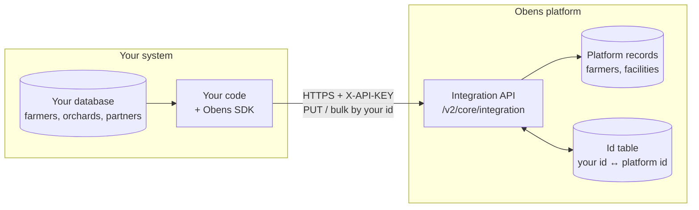
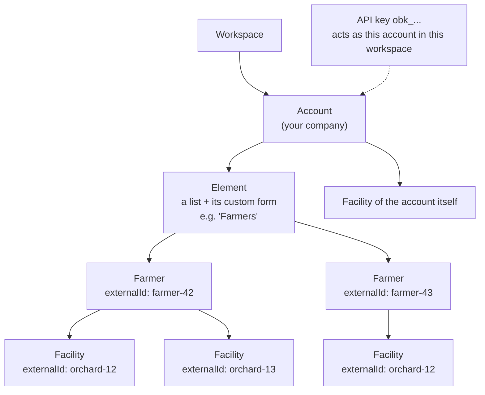
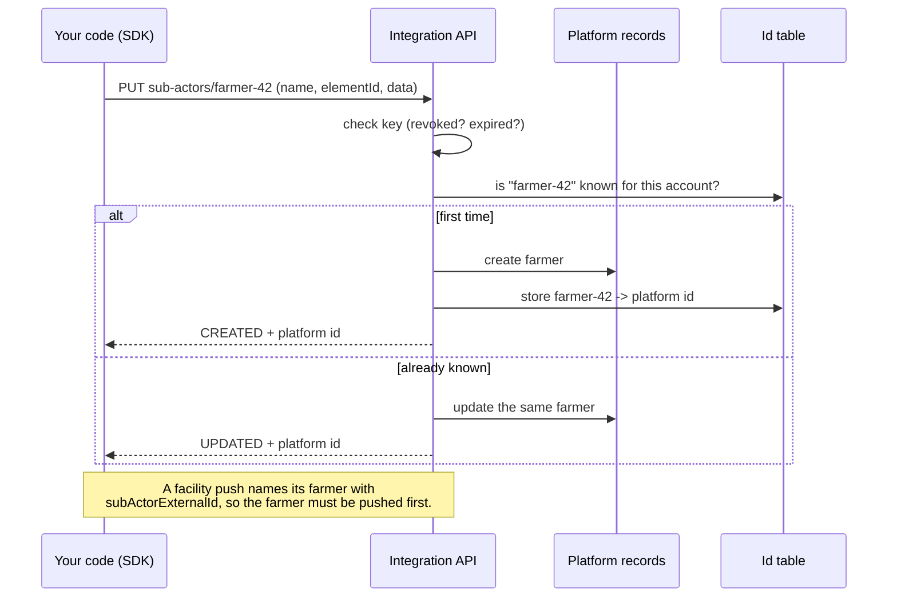
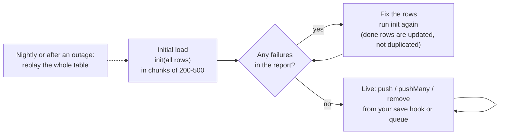
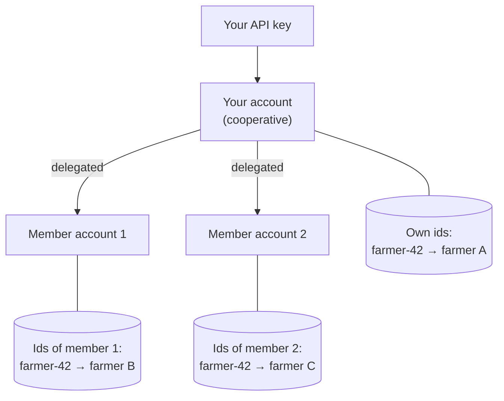
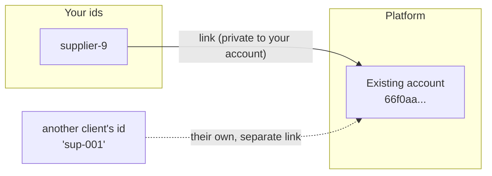

# obens-sdk (Python)

Source: https://github.com/Obens-Ltd/obens-sdk-python

Push your farmers, facilities and partners to the Obens platform under **your own ids**, and translate ids both ways.
Python 3.9+, one dependency (`requests`).

```
pip install "obens-sdk @ git+https://github.com/Obens-Ltd/obens-sdk-python@v0.1.2"
```

## How it fits together

Six small pictures of what happens behind the SDK (Mermaid diagrams, GitHub draws them).

### The big picture

Your system keeps its own ids. The SDK sends records with those ids to the platform; the platform stores its own id
next to yours and can translate either way.



### What an API key is allowed to touch

A key is bound to **one account in one workspace**. It can only see that account's records (plus accounts that
delegated to it, see below). Farmers live in an **element** (a list with its own custom form); facilities (orchards,
plots...) belong to a farmer.



Notice `orchard-12` twice: a facility id is unique **per owner**, so the same id under two farmers is two different
facilities. Farmers have their own id space, facilities have theirs.

### One push, step by step

The first push of an id creates the record, every later push updates it. That is why retries and full replays never
create duplicates.



### Load once, then push changes



### Acting for other accounts (delegation)

If other accounts have delegated to the key's account (a cooperative and its members, for example), the same key can
act on them. Each account has its **own** id space, so `farmer-42` of the cooperative and `farmer-42` of a member are
different farmers.



A revoked delegation answers `403` on the next call.

### Matching accounts that already exist

Accounts are shared between clients, so an account cannot carry your id. You **link** your id to it; the link is
private to your account.



## 1. Get an API key

In the platform: **Settings → API keys → Create key**. Pick the account and workspace it acts as. The secret
(`obk_...`) is shown **once**, store it like a password. Keys can be revoked or set to expire.

## 2. Connect

```python
import os
from obens_sdk import ObensClient

client = ObensClient("https://api.obens.so/v2/core", os.environ["OBENS_API_KEY"])

print(client.whoami())    # {'keyId', 'keyName', 'accountId', 'workspaceId'}
print(client.elements())  # the lists farmers can be created in -> you need one 'id'
```

Transient failures (timeouts, 429, 5xx) are retried with backoff. Every call is an upsert, so a retry or a replay
never duplicates a record.

## 3. Write a mapper

A mapper turns **your** record into what the platform expects. Strings are paths into your record (dict keys or
attributes), callables are computed, `constant()` is a fixed value; empty results are skipped so an update never
blanks a field.

```python
from obens_sdk import create_mapper, constant

FARMERS_ELEMENT = "<element id from client.elements()>"

map_farmer = create_mapper({
    "externalId": "id",                                   # YOUR id: required, the key of the mapping
    "name": lambda r: f"{r['first_name']} {r['last_name']}",
    "ref": "code",
    "address": "village.name",
    "gender": lambda r: {"M": "MALE", "F": "FEMALE"}.get(r["sex"]),
    "elementId": constant(FARMERS_ELEMENT),
    "type": constant("FARMER"),
})
```

Or pass any function that returns the dict.

## 4. Initial load

```python
farmers = client.syncer("sub_actors", map=map_farmer, chunk_size=200,
                        on_progress=lambda r: print(r.total))

report = farmers.init(all_rows)    # a list, or a generator over a cursor to stream a big table
print(report.created, report.updated, report.failed, report.failures)
```

One bad row never stops the load; it is listed in `report.failures`. Run `init` again after fixing them: rows already
pushed are updated, not duplicated.

## 5. Push changes

```python
farmers.push(row)           # one change: call it from your save hook / queue consumer
farmers.push_many(rows)     # a batch of changes
farmers.remove(row)         # delete (soft: the platform keeps the record)
```

Facilities work the same way:

```python
facilities = client.syncer("facilities", map=create_mapper({
    "externalId": "id",
    "info.name": "title",
    "info.address": "address",
    "coordinates": lambda r: {"type__": "Point", "latitude": r["lat"], "longitude": r["lng"]},
}))
```

### Facilities of a farmer

A farmer can own many facilities (orchards, plots...). Give the farmer's external id in `subActorExternalId` and the
facility belongs to that farmer. The farmer must have been pushed first. A facility's id is unique **per owner**, so
read it back with the same farmer:

```python
create_mapper({"externalId": "id", "subActorExternalId": "farmer_id", "info.name": "title"})
client.facilities.get("orchard-12", sub_actor="farmer-42")
```

## 6. Match your ids to platform ids

```python
ids = client.id_map("SUB_ACTOR").load()      # "SUB_ACTOR" | "FACILITY" | "ACCOUNT"
ids.internal("farmer-42")                    # -> platform id
ids.external("66f0c0...")                    # -> "farmer-42"

# link one of your partners to an account that already exists on the platform
client.accounts.link("supplier-9", "66f0aa...")
```

### Custom fields

```python
fields = client.sub_actor_schema(element_id)  # [{name, staticId, type, writable, choices}]
```

Put plain values in `data`, keyed by field `name` or `staticId`:

```python
mapper = create_mapper({
    "externalId": "id",
    "name": "full_name",
    "elementId": constant(ELEMENT_ID),
    "data": lambda r: {"Crop": r["crop"], "Area (ha)": r["area"], "Planted on": r["planted"]},
})
```

Choices accept an option's id, label or value; quantities are `{"value": 1, "unit": "kg"}`; dates are `yyyy-MM-dd`.
File, image, table and formula fields can't be written. A bad key or value fails that record with a message listing
every problem; nothing is written for it.

## Delegated accounts

If other accounts have delegated to the key's account, the same key can act on them: create their farmers and
facilities, link their partners and read their id tables.

```python
accounts = client.accounts.accessible()          # [{'id', 'name', 'self'}]: the key's own account first
coop = client.for_account(accounts[1]["id"])     # every call below now acts as that account

coop.syncer("sub_actors", map=map_farmer).init(coop_farmers)
```

Each account has its **own** id space: `farmer-42` of one account and `farmer-42` of another are different farmers.
A revoked delegation stops working on the next call (`403`).

## Errors

Failed requests raise `ObensApiError` with `status` and `body`. `401` = missing, wrong, revoked or expired key.

Full endpoint reference: `traceability-core/api-docs/integration/readme.md`.

## License

MIT, see [LICENSE](LICENSE).
